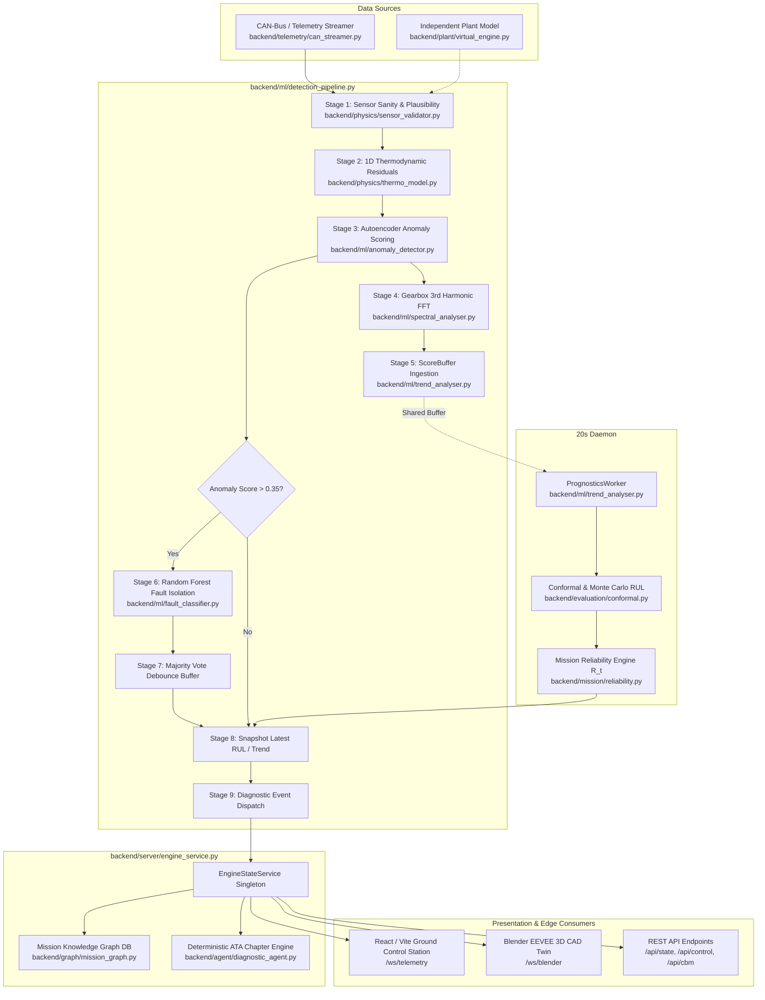

# 01. System Architecture & Topology

## 1. System Topology Overview
ANUMAAN (Rotax 912 iS MALE UAV Digital Twin & Health Monitoring System) is architected as an **Edge-Centric Hybrid Real-Time System** designed for high-stakes aerospace condition-based maintenance (CBM) and in-flight health monitoring under strict air-gapped constraints.

The system comprises four tightly synchronized runtime tiers:
1. **Authoritative Real-Time Analytics Backend (`backend/`)**:
   - Python 3.10+ / FastAPI event-driven daemon running an authoritative **20 Hz synchronous telemetry loop** (<20 ms latency budget per tick).
   - Hosts physics-based digital twins, thermodynamic solvers, statistical residual generators, bio-inspired novelty detectors, conformal prediction algorithms, and deterministic diagnostic logic.
   - Dual-channel WebSocket broadcasters (`/ws/telemetry` for web GCS, `/ws/blender` for CAD visualization).
2. **Ground Control Station Frontend (`frontend/`)**:
   - Single-Page Application (SPA) built on React 18, TypeScript, and Vite.
   - Decoupled into tactical pilot, propulsion engineer, and maintenance crew roles with sub-millisecond local state updates (Zustand + WebSockets).
   - Embedded 3D hardware-accelerated telemetry-synchronized viewports via Three.js / React Three Fiber (`@react-three/fiber`, `@react-three/drei`).
3. **Desktop Native Simulation Clients (`apps/`)**:
   - Native Blender 3D digital twin client (`apps/blender_twin/standalone_digital_twin_app.py`) driven by Blender's EEVEE engine via Python `bpy`, receiving component-level mesh highlight commands over WebSockets.
   - Standalone Ladakh-canyon flight simulator (`apps/blender_twin/standalone_canyon_flight_app.py`) for terrain-following and mission profile execution.
   - Lightweight hardware-accelerated Pygame desktop HUD (`apps/desktop_gcs/`).
4. **Air-Gapped Offline Knowledge & Reasoning Fabric (`backend/knowledge/`, `backend/agent/`)**:
   - In-memory vector database and BM25 hybrid semantic search (`backend/knowledge/retrieval/`) indexing aerospace manuals (`data/documents/`).
   - Deterministic ATA-chapter diagnostic rule engine (`backend/agent/diagnostic_agent.py`) paired with local LLM copilot (`LocalLLMEngine` wrapping local Qwen/Nemotron models).

---

## 2. Core Architectural Design Patterns

### A. Digital Twin with Residual Separation (Physics-First Inference)
The platform strictly decouples raw sensor inputs from machine learning classifiers. Raw sensor data is validated for physical plausibility (`backend/physics/sensor_validator.py`) and fed into a first-principles 1D thermodynamic model (`backend/physics/thermo_model.py`). The ML pipeline never ingests raw temperatures or pressures directly; it operates exclusively on the **Residual Vector**:
$$\mathbf{r} = \mathbf{y}_{\text{measured}} - \mathbf{y}_{\text{thermo\_expected}}$$
This ensures zero drift under nominal flight transitions (climb, loiter, throttle snaps) because the physics model tracks nominal thermodynamic shifts natively.

### B. Independent Plant Architecture (G01 Benchmark Decoupling)
To eliminate self-validation bias where an algorithmic twin monitors synthetic data generated by its own equations, ANUMAAN incorporates an independent plant model (`backend/plant/virtual_engine.py` mediated by `backend/plant/adapter.py`). The independent plant models component-level manufacturing tolerances, sensor calibration offsets, thermal lag coefficients, and hidden mechanical faults, ensuring residuals reflect authentic physical discrepancy.

### C. Gated 9-Stage Pipeline with Debouncing
The 20 Hz hot-path (`backend/ml/detection_pipeline.py`) processes 27 parameters per tick across 9 stages:
- **Stages 1–5**: Sub-millisecond sanity filtering, thermodynamic residual computation, Autoencoder reconstruction loss calculation, gearbox FFT order tracking, and score buffer writes.
- **Stage 6 (Gated Fault Isolation)**: The multi-class Random Forest classifier (`RotaxFaultClassifier`) only executes if the continuous anomaly score exceeds `ANOMALY_GATE` (0.35).
- **Stage 7 (Majority Vote Debouncing)**: Suppresses single-frame transient spikes via a sliding debounce buffer (`MajorityVoteBuffer`) before emitting alerts.

### D. Multi-Rate Decoupled Threading Model
- **20 Hz Real-Time Thread**: `DetectionPipeline.process_frame()` executes strictly within a <20 ms window on the main loop.
- **Background Prognostics Daemon**: `PrognosticsWorker` runs asynchronously every 20 seconds, reading from a thread-safe circular buffer (`ScoreBuffer`) protected by `ml_runtime_lock.py`. It performs heavy Arrhenius thermal degradation curve fitting, Monte Carlo life distributions, and conformal prediction calculations without stalling telemetry ingestion.

---

## 3. End-to-End Data Flow Architecture

