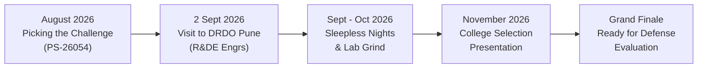

# Our SIH Journey

Before ANUMAAN was a project with thousands of lines of code, physics equations, and 3D engine models, it was just a group of college students sitting together with hot cups of tea, staring at an intimidating problem statement from DRDO.

This is the real, unvarnished story of our Smart India Hackathon (SIH 2026) journey: the late-night lab sessions, the visit to DRDO in Pune that changed everything, the bugs that kept us awake until 4 AM, and the pride of presenting our working system to our college professors.

---

## The Journey at a Glance

---

## Chapters in Our Story

### [Chapter 01: From an Empty Screen to a Working Twin](journey/01-the-engineering-story)
How six students picked one of the toughest defense problem statements in SIH, visited the DRDO R&DE (Engrs) facility in Pune on 2nd September, and spent weeks of sleepless nights turning textbook formulas and Blender models into a living, breathing digital twin.

### [Chapter 02: Facing the Evaluators: College Round to the Grand Finale](journey/02-preparing-for-evaluation)
The nervous energy outside the RSCOE incubation center, standing before senior college professors, opening our laptops to run live failure simulations, answering tough questions from the panel, and earning our spot to represent our institute.

---

> "We did not want to build just another hackathon demo with fake sliders and pre-recorded videos. We wanted to build something that a real UAV pilot or engineer could trust."
