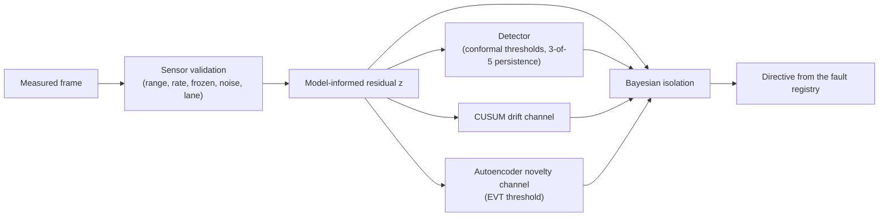

# Residual Analysis

A residual is what is left of a reading after everything the physics can explain has been subtracted. ANUMAAN's detection, isolation and explanation all work on residuals, so the quality of the residual sets the quality of everything downstream. This page describes how the residual is built, why each step exists, and what it achieves on the simulated fleet.

---

## 1. The model-informed residual

For every frame, in time order, and for every monitored channel $c$ (each cylinder head temperature, each exhaust gas temperature, oil pressure, oil temperature, fuel flow, manifold pressure, engine speed):

$$r_c(t) = y_c(t) - \underbrace{\hat y_c^{\,\text{model}}(t)}_{\text{nominal physics}} - \underbrace{\hat y_c^{\,\text{tail}}(t)}_{\text{this engine's offset}}, \qquad z_c(t) = \frac{r_c(t)}{\sigma_c}$$

**Nominal physics, $\hat y^{\text{model}}$.** The same engine model that drives the simulator (mean-value air path, combustion, ECU schedules, thermal network) runs alongside the stream, driven only by measured inputs: lever position, engine speed, altitude, outside air temperature, airspeed and, on spark-ignition engines, the ECU-published ignition timing.

| Channel group | How the nominal value is predicted |
|---|---|
| Manifold pressure, fuel flow | Steady operating point of the mean-value engine at the measured lever and speed, including the ECU mixture map (ECO/POWER), knock retard and the turbo controller's boost schedule |
| Cylinder head, exhaust, oil temperatures | The thermal network **integrated in time** with those heat inputs, so slow temperatures follow a lever change with their real time constants instead of jumping |
| Oil pressure | Pump and relief-valve law at the measured speed and oil temperature |
| Engine speed | Propeller balance from the lever alone (governed propeller: the set speed; fixed pitch: brake power = propeller power), capped by the ECU rev limiter where the engine has one |

**This engine's offset, $\hat y^{\text{tail}}$.** No two engines are built alike. A short nominal run identifies the tail:

1. *Physical identification.* Volumetric efficiency is the median ratio of measured to predicted fuel flow (fuel follows air on a mixture-controlled engine). The friction factor is the value that best explains the measured oil temperature (a three-point parabola fit). Both are applied to the tail's own copy of the model.
2. *Statistical correction.* A ridge regression per channel learns the remaining small offset from a smooth command polynomial, four model outputs (brake power, balance speed, fuel, manifold pressure ratio) and the channel's own predicted rise above ambient. Multiplicative build spread then becomes linear.
3. *Robust scale.* Rows more than six robust standard deviations away (for example an overspeed fuel cut during the calibration run) are excluded before $\sigma_c$ is estimated.

**What is never used.** The residual reads the measured frame and the engine configuration only. It never sees the simulator's truth or the list of injected faults; an automated test (`tests/test_no_truth_leak.py`) scans the inference packages to keep it that way.

---

## 2. Why each step was needed (measured)

One nominal flight hour per engine, six ten-minute legs (60 %/9,000 ft, 75 %/12,000 ft, 90 %/15,000 ft, 55 %/5,000 ft, 70 %/9,000 ft, 85 %/3,000 ft), test tail seed 1001. The table shows confirmed false-alarm episodes per flight hour as each step was added. Evidence class: SIMULATION.

| Residual design | AE300 | 912 iS | 914 | 915 iS | VRDE |
|---|---|---|---|---|---|
| Quadratic in the commands only | 5 | 12 | 9 | 1 | 6 |
| + nominal model predictions | 6 | 0 | 9 | 15 | 27 |
| + measured timing, tail identification, robust scale | 1 | 0 | 0 | 11* | 0 |

\* The remaining 915 iS episodes all occur at 90 % lever above 12,000 ft, where the fixed-pitch engine runs in its rev limiter (an overspeed condition the status evaluator reports in its own right). Inside the limiter the fuel-cut cycle is faster than the 1 Hz frame, so fuel flow, exhaust temperature and speed carry no evidence there and only the slow temperatures are scored.

The same change made the detector more sensitive, because the per-channel scale $\sigma_c$ shrank. Cylinder head temperature noise fell from about 3.2 °C to 0.8 °C, and a radiator blockage (F21) on the 914 is now confirmed after 193 s instead of 904 s.

---

## 3. From residual to decisions

- **Sensor validation first.** A quarantined channel gets $z_c = 0$ (no evidence) and is published as a virtual value from the state observer.
- **Detection** uses three scorers on a 13-feature summary of $z$ (cylinder blocks are summarised by mean, max, min and spread, so four- and six-cylinder engines share one detector): FlyHash familiarity, Mahalanobis distance with Ledoit–Wolf shrinkage, and the largest $|z|$. Each has a split-conformal threshold from held-out nominal frames and must persist 3 of 5 frames. See [The AI and ML Architecture](09-ai-ml-architecture.md).
- **Isolation** uses the unclipped $z$ vector. See [Fault Diagnosis](11-fault-diagnosis.md).

---

## 4. Sensor fault or engine fault?

A failed sender moves one channel. A real fault moves its physically coupled channels together. ANUMAAN uses both facts:

- One-channel checks (dropout, impossible value, impossible rate, frozen, excess noise, lane disagreement) catch the obvious sender failures within 0–9 s at about 0.3 ms per frame.
- A bias or slow drift looks like a real change on one channel, so it is left to the isolator. There it competes as a "sensor offset" hypothesis against every process fault. The isolator also knows which sensors are model **inputs**. A biased oil-temperature sender shifts the *predicted* oil pressure, while a genuinely hotter oil does not, and that difference separates the two.
