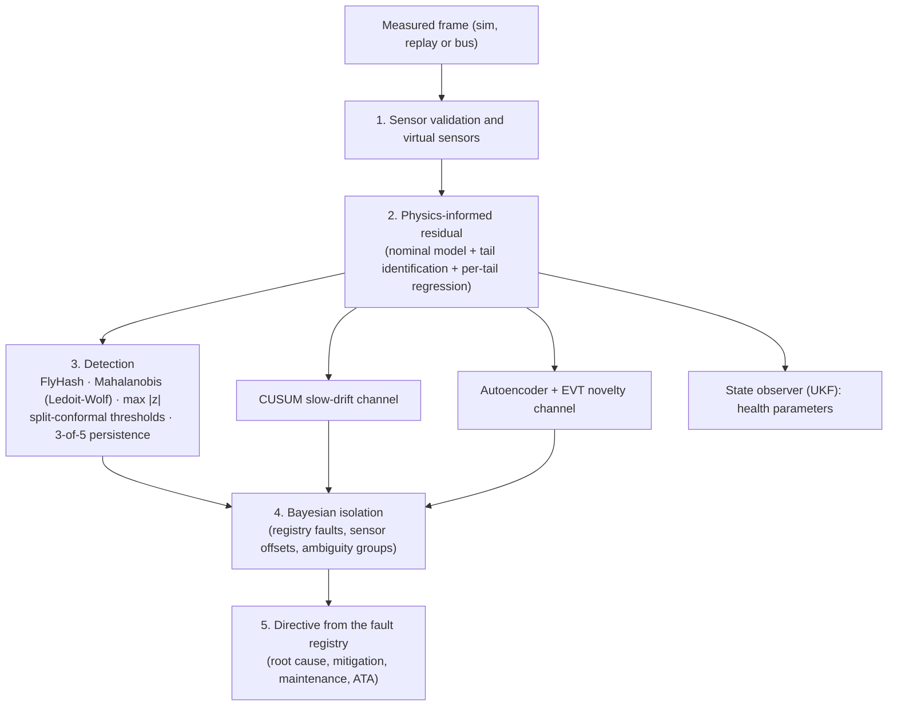

# The AI and ML Architecture

ANUMAAN does not ask one neural network to answer "is this normal?", "what is failing?", "how long will it last?" and "can the mission continue?". Each question gets the method that suits it, and every method works on the same foundation: a **physics-informed residual** (what the measured engine does that the nominal engine model, tuned to this tail, does not explain). Physics removes everything that is expected (altitude, lever, ECU schedules, thermal lag), so the learning components see only the unexplained part and need far less data.

---

## The stack

| Stage | Technique | Why this technique | Where |
|---|---|---|---|
| Sensor validation | Range, rate, frozen-window variance, robust noise (median second difference), lane disagreement; quarantined channels replaced by the observer's estimate (VIRTUAL) | A failed sender must not look like an engine fault; one-channel checks are instant and explainable | `backend/detect/sensor_fdi.py` |
| State observer | Unscented Kalman filter on the thermal network, health parameters as random-walk states | Tracks slow degradation (cooling, radiator, oil cooler) as physical parameters, not black-box scores | `backend/twin/sim_ukf.py` |
| Residual | Nominal engine model on measured inputs; tail identification (volumetric efficiency, friction); per-channel ridge regression with model regressors; robust MAD scale | Removes the operating point so one detector serves every engine and condition; see [Residual Analysis](08-residual-analysis.md) | `backend/detect/reference.py`, `calibration.py` |
| Detection | Three scorers on a 13-feature residual summary, split-conformal thresholds on held-out nominal frames, 3-of-5 persistence | Conformal thresholds give a finite-sample false-alarm bound on nominal frames of the calibration distribution; persistence trades a few seconds for far fewer nuisance alarms | `backend/detect/detector.py`, `scorers.py` |
| Novelty | FlyHash expand-and-sparsify familiarity (see [Bio-Inspired Sparse Novelty Coding](10-bio-inspired-sparse-novelty-coding.md)); autoencoder (16-4-16 tanh MLP) reconstruction error with a Generalized Pareto peaks-over-threshold threshold | EVT extrapolates the false-alarm level beyond what the held-out sample can resolve (an empirical quantile at α = 10⁻⁴ needs 10,000 frames) | `backend/detect/autoencoder.py` |
| Slow drift | Two-sided CUSUM on the residual vector | Catches drifts that never cross a one-frame threshold | `backend/detect/cusum.py` |
| Isolation | Bayesian posterior over registry faults and per-sensor offsets; Gaussian likelihood with severity integrated out in closed form; FMECA-occurrence priors; calibrated signatures | Gives a probability, the cylinder, the estimated severity and the honest alternatives, and separates a sensor offset from an engine fault | `backend/diagnose/isolator.py`, [Fault Diagnosis](11-fault-diagnosis.md) |
| Directive | Deterministic lookup in the fault registry (never generated text) | Maintenance and in-flight actions must be traceable to a source | `backend/diagnose/directive.py` |

Prognostics (remaining useful life with conformal intervals) and mission reliability are built on top of these outputs in the next phases; their pages describe them as they land.

---

## Measured behaviour (evidence class: SIMULATION)

| Measure | Result |
|---|---|
| Nominal varied-lever flight hour, confirmed false-alarm episodes | AE300 1, 912 iS 0, 914 0, VRDE 0; 915 iS 11, all inside its rev limiter at 90 % lever above 12,000 ft |
| Sensor validation latency | ~0.3 ms per frame |
| Sender faults caught (stuck, dropout, out of range, lane split, noise) | 0–9 s after onset |
| Autoencoder EVT threshold | exceedance within a factor of 2 of α = 10⁻⁴ from 2,000 held-out scores (synthetic heavy tail) |
| Autoencoder scoring cost | ~21 µs per frame (numpy forward pass) |
| Five engines at 20 Hz, all stages | under the 20 ms tick budget |

Simulation results are never quoted as flight performance. Every number above comes from simulated engines with per-tail build spread and sensor noise. Test tails (seeds ≥ 1000) are separate from the tails used to build signatures (seeds 11, 12).

---

## Design rules that keep it honest

- **No truth leaks.** Detection, isolation, status and highlights read only the measured frame and configuration. A test scans these packages for any access to the simulator's truth.
- **No invented numbers.** A missing reading is "no data", never a default value.
- **Every threshold has a source:** a conformal quantile, an EVT fit, an engine manual limit, or a value marked ASSUMED in the configuration.

---

## Related Systems

- [Residual Analysis](08-residual-analysis.md)
- [Bio-Inspired Sparse Novelty Coding](10-bio-inspired-sparse-novelty-coding.md)
- [Fault Diagnosis and Isolation](11-fault-diagnosis.md)
- [Vibration Analysis and Order Tracking](12-vibration-analysis.md)
- [Remaining Useful Life Estimation](14-remaining-useful-life.md)
- [Mission Reliability Enhancement](17-mission-reliability.md)
