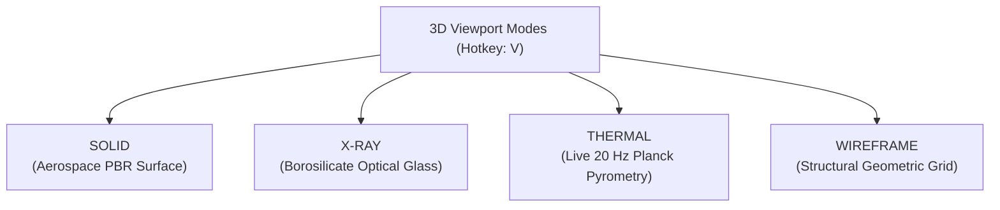
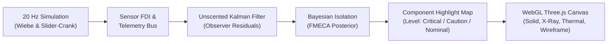

# The 3D Digital Twin

A fault report is fundamentally a set of numerical vectors: a sensor channel name, an analytical residual delta, and a posterior probability. An operator inspecting a physical engine does not think in sensor channels, they think in components: this cylinder head, this high-pressure injector, this reduction gearbox bearing. The 3D digital twin bridges that cognitive divide by rendering the active propulsion platform as an interactive, photorealistic model. The specific component identified by Bayesian fault isolation illuminates with alert highlights, synchronized in real time to the same 20 Hz multi-physics telemetry stream powering the operator console.

Three visualization tracks operate within ANUMAAN:
1. **The WebGL 3D Twin**: Running in-browser inside the Ground Control Station (React 18 + Three.js / React Three Fiber), providing hardware-accelerated 60 FPS multi-mode engine inspection.
2. **The Blender Master Twin**: Authoritative high-fidelity digital twin asset pipeline utilized for photorealistic ray-traced validation and CAD geometry curation.
3. **The Terrain-Coupled Tactical Visualizer**: Dynamic glide reachability footprints and unpowered emergency divert cones projected over 3D terrain elevation.

All three tracks consume one authoritative runtime state produced by the backend physics engine. Telemetry, fault propagation, and state observer residuals are computed once at 20 Hz, ensuring zero discrepancies between the 3D canvas and numeric flight indicators.

---

## The Four Specialized Viewport Modes

Rather than offering only a static CAD render, ANUMAAN implements four specialized 3D viewport rendering modes that can be selected from the top-right flight deck toolbar or cycled instantly using keyboard shortcut `V`:

### 1. SOLID CAD Surface (`solid`)
Restores authentic aerospace Physically Based Rendering (PBR) engineering materials:
* **Crankcase & Cylinder Barrels**: Die-cast aluminum alloy with micro-facet roughness and baked ambient occlusion.
* **Valve Covers & Cylinder Heads**: Anodized finish (signature Rotax green/blue) with metallic sheen.
* **Exhaust Manifold & Turbo Headers**: Heat-tinted stainless steel alloy with high thermal oxidation roughness.
* **Intake Runners & Plenums**: Powder-coated cast aluminum with subtle specular roughness.

### 2. Physical X-Ray Glass (`glass`)
Transforms the exterior engine casing and rocker covers into optical borosilicate transmission glass using Three.js `MeshPhysicalMaterial`:
* **Transmission Factor**: $0.92$ (genuine optical transmission allowing light transmission through outer walls).
* **Index of Refraction (IOR)**: $1.48$ (calibrated borosilicate optical glass refraction).
* **Roughness**: $0.12$, **Metalness**: $0.05$, **Thickness**: $0.8\text{ mm}$, **Clearcoat**: $1.0$.
* **Mechanical Exposing**: The outer casing becomes transparent while internal reciprocating assemblies (pistons, connecting rods, wrist pins, and the crankshaft) remain opaque PBR, allowing operators to visually inspect reciprocating kinematic motion inside the running engine.

### 3. Dynamic FLIR Thermal Pyrometry (`thermal`)
Provides real-time forward-looking infrared (FLIR) thermal incandescence visualization driven directly by 20 Hz thermodynamic telemetry:
* **Casing Shader**: The exterior engine block transitions to non-emissive smoked obsidian glass (transmission $0.85$, color `#1a1a24`).
* **Live Telemetry Coupling**: Live Cylinder Head Temperatures ($CHT_1 \dots CHT_4$) and Exhaust Gas Temperatures ($EGT_1 \dots EGT_4$) drive dynamic emissive shaders on individual cylinder heads and exhaust runners.
* **Mathematical Color-Ramp Mapping**:
  $$\text{Normalized CHT: } t_{\text{cht}} = \text{clamp}\left(\frac{T_{\text{cht}} - 50}{90},\ 0,\ 1\right) \quad [50^\circ\text{C} \dots 140^\circ\text{C}]$$
  $$\text{Normalized EGT: } t_{\text{egt}} = \text{clamp}\left(\frac{T_{\text{egt}} - 400}{550},\ 0,\ 1\right) \quad [400^\circ\text{C} \dots 950^\circ\text{C}]$$
* **Blackbody Incandescence Spectrum**:
  * $40^\circ\text{C}$ to $60^\circ\text{C}$: Deep Slate / Indigo (`#334155`)
  * $85^\circ\text{C}$: Cool Teal (`#0d9488`)
  * $100^\circ\text{C}$: Nominal Green (`#10b981`)
  * $120^\circ\text{C}$: Elevated Amber (`#f59e0b`)
  * $\ge 135^\circ\text{C}$: Critical Red (`#ef4444`)
  * $\ge 900^\circ\text{C}$: Incandescent Thermal White (`#ffffff`)
* **Real-Time HUD Overlay**: Accompanied by the floating `ThermalLegend` HUD displaying per-cylinder temperature readouts and hot-section exhaust limits.

### 4. Wireframe Structural Overlay (`ghost`)
Renders an additive holographic wireframe grid across the engine geometry. This mode enables maintenance technicians to inspect component alignment, identify geometric clearances, and detect structural departure between the nominal CAD model and physical deformation.

---

## Flight Deck Controls & Ergonomics

The 3D twin stage integrates aerospace flight deck controls designed for zero latency and rapid keyboard execution:

| Keybinding / Control | Action | Operational Function |
| :--- | :--- | :--- |
| **`V`** | **Cycle 3D View Modes** | Sequentially toggles between `SOLID`, `X-RAY`, `THERMAL`, and `WIREFRAME` with instant operator feedback notices. |
| **`X`** | **Clear All Faults** | Removes all operator-injected faults (`DELETE /faults`), invokes `/status/acknowledge`, settles physical transients, and resets the camera rotation axis back to engine center `[0, 0.05, 0]`. |
| **`R`** | **Reset & Restart Engine** | Complete flight-line reboot: clears faults, resets engine state machine, flushes thermal buffers, and restarts the engine from zero RPM to nominal idle. |
| **`1` to `9`** | **Inject Fault Scenario** | Instantly injects selected simulated failure (misfire, injector clog, knock, coolant loss) on the targeted cylinder. |
| **`C`** | **Cycle Target Cylinder** | Cycles target cylinder selection ($1 \dots 4$) for single-cylinder localized anomalies. |
| **`F`** | **Refocus 3D Camera** | Automatically pivots and zooms the 3D camera directly onto the primary component identified by Bayesian fault isolation. |
| **`T`** | **Training Mode Toggle** | Toggles purple classroom training highlights on injected parts before the diagnostic AI independently isolates the issue. |
| **`Ctrl+K`** | **Tactical Command Palette** | Opens keyboard-first launcher to search engines, switch platforms, and command throttle. |
| **`?`** | **Twin Architecture Guide** | Opens full operator architecture guide and flight controls reference modal. |
| **Rotating / Paused** | **Auto-Rotation Toggle** | Toggles smooth 360-degree orbit rotation around the engine center coordinates. |

---

## The Five-Engine Propulsion Fleet

ANUMAAN covers five distinct aero-piston powerplants across military and civilian MALE UAV configurations:

### 1. Rotax 912 iSc Sport (Reference Naturally Aspirated)
* **Architecture**: 4-cylinder horizontally opposed boxer, 4-stroke, liquid-cooled cylinder heads with air-cooled cylinders.
* **Displacement**: $1,352\text{ cm}^3$, dry-sump forced lubrication with external oil tank.
* **Induction & Fuel**: Naturally aspirated, dual redundant electronic fuel injection and digital ignition (FADEC).
* **Performance**: $100\text{ hp}$ ($73.5\text{ kW}$) at 5,800 RPM.
* **Operational Application**: Primary evaluation baseline for DRDO PS-26054, tactical reconnaissance UAVs, and line trainers.

### 2. Rotax 914 F Turbo (Turbocharged High-Altitude Patrol)
* **Architecture**: 4-cylinder boxer with integrated exhaust turbocharger and automatic Wastegate Turbo Control Unit (TCU).
* **Displacement**: $1,211\text{ cm}^3$, dual constant-depression carburetors with electronic manifold pressure regulation.
* **Performance**: $115\text{ hp}$ ($84.6\text{ kW}$) takeoff rating, $1.35\text{ bar}$ max boost pressure.
* **Operational Application**: High-altitude patrol UAVs (Rustom-I, Searcher-II) with critical altitude capability up to 25,000 ft.

### 3. Rotax 915 iSc (Turbocharged Intercooled High-Altitude Sprint)
* **Architecture**: 4-cylinder boxer combining forced induction, air-to-air charge intercooling, and dual redundant digital injection.
* **Displacement**: $1,352\text{ cm}^3$, stainless steel exhaust system.
* **Performance**: $141\text{ hp}$ ($104\text{ kW}$) takeoff power, sustained continuous climb power up to 15,000 ft critical altitude.
* **Operational Application**: Long-endurance tactical surveillance platforms (Archer, Rustom-II).

### 4. Austro Engine AE300 (Common-Rail Heavy-Fuel Aero Diesel)
* **Architecture**: 4-cylinder in-line liquid-cooled compression-ignition engine with reduction gearbox and dual mass flywheel.
* **Displacement**: $1,991\text{ cm}^3$, high-pressure common rail direct injection (1,800 bar).
* **Fuel Compatibility**: Aviation kerosene (Jet-A1, Jet-A, JP-8).
* **Performance**: $168\text{ hp}$ ($123.5\text{ kW}$) at 3,880 RPM crankshaft speed.
* **Operational Application**: Maritime patrol UAVs and heavy-fuel defense logistics aircraft.

### 5. VRDE Jayem 2.2L (Indigenized Defense Heavy-Fuel Powerplant)
* **Architecture**: 4-cylinder turbocharged compression-ignition diesel indigenously developed by Vehicles Research and Development Establishment (VRDE, DRDO) and Jayem Automotives.
* **Displacement**: $2,179\text{ cm}^3$, common-rail direct fuel injection with intercooled turbocharging.
* **Performance**: $180\text{ hp}$ ($132\text{ kW}$) defense rating.
* **Operational Application**: Indigenous Indian MALE UAV platform (ADE Tapas-BH-201).

---

## Component Binding & Zero Truth-Leak Architecture

The flow from physics simulation to 3D highlight is strictly unidirectional:

Under project airworthiness rules (P Part 0 Rule 4 and tests in `tests/test_no_truth_leak.py`), the 3D twin highlight subsystem never reads the injected fault list or simulator ground truth. Highlights occur only when analytical residuals exceed calibrated thresholds and the Bayesian network confirms component attribution through real telemetry channels.

---

## Related Systems

- [Engine Physics and Thermodynamics](06-engine-physics.md)
- [Telemetry, Avionics Interfaces & Sensor Intelligence](07-telemetry-and-sensors.md)
- [The Operator Ground Control Station](20-operator-gcs.md)
- [Technology Stack, Repository Architecture & Fleet Intelligence](23-technology-stack.md)
