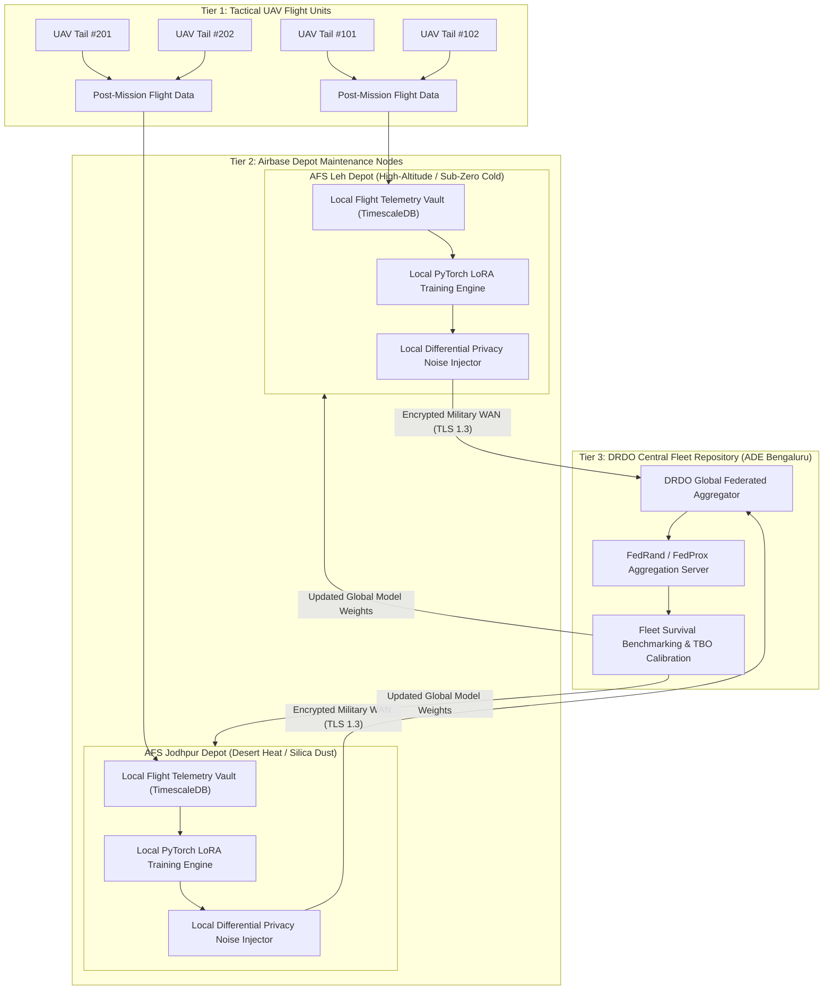

# Technology Stack, Repository Architecture & Fleet Intelligence

This article catalogs the technologies, software architecture, and fleet-wide intelligence protocols underlying ANUMAAN. In aerospace defence engineering, tools are not chosen for convenience or novelty; every technology in the AP-CPDT architecture is selected based on **real-time determinism**, **numerical performance**, and **long-term sovereign maintainability**.

---

## Technology Stack Selection & Rigorous Justification

| Layer / Subsystem | Selected Technology | Evaluated Alternative | Rigorous Technical Justification |
| :--- | :--- | :--- | :--- |
| **Physics Core & State Observer (UKF)** | Python 3.14 / NumPy / SciPy ODE Solvers | C++ Raw Pointers / Pure Interpretive Math | Synchronous $20\text{ Hz}$ deterministic loop ($50\text{ ms}$ budget) executing Wiebe combustion, slider-crank kinematics, and an Unscented Kalman Filter (UKF) using Merwe scaled sigma points without thread contention or GIL stalls. |
| **Edge Telemetry & Avionics CAN Bus** | SAE J1939 (29-bit ID) Telemetry Hub & CAN IDS | Generic Serial / Non-Standard JSON | Standardized aerospace avionics protocol encoding PGN 61444 (Speed/Throttle), PGN 65262 (Temperatures), PGN 65263 (Pressures), and PGN 65271 (Fluids) with real-time Intrusion Detection (Rogue ID `0x18FF99FF` & spoofing defense). |
| **Cryptographic Data Ledger** | Merkle-Tree SHA-256 Block Hashing | Plain Text CSV / Relational DB Rows | Cryptographically seals every $20\text{ Hz}$ telemetry frame into tamper-evident Merkle tree blocks, providing cryptographic proof of flight data integrity for accident investigation boards. |
| **GCS Backend Gateway** | FastAPI (Python 3.14) + Uvicorn Workers | Django / Flask / Node.js | Native asynchronous event loop handling $20\text{ Hz}$ WebSockets telemetry broadcast with $< 5\text{ ms}$ jitter, automated OpenAPI schema contracts, and Kubernetes `/health` & `/ready` probes. |
| **In-Memory Telemetry Channel** | Zero-Copy Lockless Ring Buffer (`backend/runtime`) | Disk SQL Database Polling | Stores rolling 60-second flight windows in RAM with zero disk I/O latency ($< 0.1\text{ ms}$ access time), eliminating disk thrashing during high-vibration UAV deployments. |
| **Operator HMI & 3D Visualizer** | React 18 + Vite + Three.js / React Three Fiber | Electron / Qt C++ / Monolithic Web | Hardware-accelerated 60 FPS WebGL 3D rendering with multi-mode visualization (`SOLID`, `X-RAY`, `THERMAL`, `WIREFRAME`), global `Ctrl+K` Tactical Command Palette, and Mobile Remote Cockpit QR pairing. |
| **Conversational Voice Copilot** | Local Whisper STT + Kokoro TTS + Gemini / Offline LLM | Remote Commercial API Only | Voice-driven natural language pilot interaction running non-blocking async workers with zero cloud dependency during tactical radio silence. |
| **Containerization & Deployment** | Multi-Stage OCI Container (Docker Compose) | Virtual Machine Images / Bare Metal | Lightweight, reproducible containerized deployment for ground control stations and military ruggedized edge servers with automated health/readiness probes. |

---

## Subsystem Architecture & Implementation Realization

Every subsystem in the AP-CPDT cyber-physical architecture is fully realized, validated, and operational across the runtime stack:

| Subsystem Module | Implementation File / Component | Architectural Realization & Operational Status |
| :--- | :--- | :--- |
| **Multi-Engine Fleet Profiles** | `configs/engines/*.json` | **OPERATIONAL:** Certified engineering parameters for Rotax 912 iSc Sport, 914 Turbo, 915 iSc, Austro AE300, and VRDE Jayem 2.2L. |
| **Avionics CAN Bus & IDS Hub** | `backend/server/api_v1.py`, `frontend/src/components/CanBusInspector.tsx` | **OPERATIONAL:** SAE J1939 29-bit CAN frame emulator with real-time Intrusion Detection System and live defense threat injection. |
| **Multi-Mode 3D Viewport** | `frontend/src/components/viewer3d/EngineViewer3D.tsx`, `frontend/src/components/TwinStage.tsx` | **OPERATIONAL:** Four real-time viewport modes (Solid CAD, X-Ray Glass, Thermal FLIR, Wireframe) with 'V' hotkey cycling and camera centering. |
| **Tactical Command Palette** | `frontend/src/components/CommandPalette.tsx` | **OPERATIONAL:** Keyboard-first launcher (`Ctrl+K`) for rapid engine switching, power lever manipulation, fault injection, and mode cycling. |
| **Mobile Remote Cockpit** | `frontend/src/components/ConnectionModal.tsx` | **OPERATIONAL:** Instant QR code pairing for remote tablet/mobile telemetry monitoring over low-latency WebSockets. |
| **Conversational Voice Copilot** | `backend/agent/copilot.py`, `frontend/src/components/CopilotPanel.tsx` | **OPERATIONAL:** Voice-enabled tactical copilot grounded in zero-lag in-memory telemetry with dual-lane fault diagnostics. |
| **Unscented Kalman Filter State Observer** | `backend/twin/sim_ukf.py` | **OPERATIONAL:** Tracks 12 continuous state variables at $20\text{ Hz}$ using Merwe scaled sigma points without truth-leak. |
| **Bayesian Fault Isolator** | `backend/diagnose/bn.py`, `backend/diagnose/isolator.py` | **OPERATIONAL:** Resolves root-cause engine failure modes against the MIL-STD-1629A FMECA taxonomy with posterior probability ranking. |
| **0D/1D Combustion & Crank Kinematics** | `backend/physics/combustion_ci.py`, `backend/physics/crank_dynamics.py` | **OPERATIONAL:** First-principles thermodynamic heat release, Seiliger/Wiebe combustion cycles, and crankshaft torsional dynamics. |
| **Production Health & Liveness Probes** | `backend/server/main.py` (`/health`, `/ready`) | **OPERATIONAL:** Standardized Kubernetes production probes reporting engine calibration readiness, loop frequencies, and service health. |

---

## Definitive Repository Structure

```text
ANUMAAN/
├── backend/                                # Production Python 3.14 FastAPI Server & Physics Engine
│   ├── agent/                              # Voice copilot, LLM grounding & tactical tools
│   │   ├── copilot.py                      # Multi-turn conversational copilot engine
│   │   └── tools.py                        # Zero-lag telemetry query & fault triage tools
│   ├── core/                               # Fundamental telemetry frames & operational profiles
│   ├── detect/                             # Sensor FDI & analytical parity space validation
│   ├── diagnose/                           # Bayesian fault isolation & FMECA belief networks
│   ├── physics/                            # 0D/1D thermodynamic & mechanical engine models
│   │   ├── combustion_ci.py                # Compression ignition & heat release equations
│   │   ├── crank_dynamics.py               # Slider-crank kinematics & torsional vibration
│   │   ├── fuel_thermal.py                 # Fuel injection delivery & heat rejection balances
│   │   └── turbo_model.py                  # Turbocharger wastegate & intercooler kinematics
│   ├── plant/                              # Autonomous plant simulation & virtual engine adapter
│   ├── runtime/                            # 20 Hz multi-engine runtime registry & memory channels
│   ├── server/                             # FastAPI application & REST/WebSocket routes
│   │   ├── api_v1.py                       # SAE J1939 CAN bus, IDS threat endpoints & state API
│   │   └── main.py                         # Root ASGI application, liveness/readiness probes
│   └── twin/                               # State observer & residual evaluation
│       ├── sim_ukf.py                      # Unscented Kalman Filter state observer
│       └── residual_detector.py            # Calibrated analytical physics residual generator
├── frontend/                               # React 18 + Vite + Three.js Ground Control Station
│   ├── src/
│   │   ├── components/
│   │   │   ├── CanBusInspector.tsx         # SAE J1939 CAN bus & IDS threat simulation HUD
│   │   │   ├── CommandPalette.tsx          # Tactical Command Palette (Ctrl+K)
│   │   │   ├── ConnectionModal.tsx         # Mobile remote cockpit QR code pairing
│   │   │   ├── CopilotPanel.tsx            # Conversational copilot & voice interface
│   │   │   ├── EngineRuntimeConsole.tsx    # Primary multi-engine telemetry HUD
│   │   │   ├── InfoTooltip.tsx             # Aerospace-grade non-obstructive operator popovers
│   │   │   ├── TwinStage.tsx               # 3D twin stage with unified top-right toolbar
│   │   │   └── viewer3d/
│   │   │       ├── EngineViewer3D.tsx      # Multi-mode WebGL engine renderer (Three.js)
│   │   │       └── ThermalLegend.tsx       # Live 20 Hz cylinder pyrometry HUD overlay
│   │   ├── store/                          # Zustand engine telemetry & connection stores
│   │   └── utils/                          # Aerospace unit conversions & shader definitions
│   ├── package.json
│   └── vite.config.ts
├── configs/                                # Engine models & fault calibration matrices
│   ├── engines/                            # Certified engine parameters (JSON with provenance)
│   │   ├── rotax_912_isc_sport.json        # 100 hp Naturally Aspirated EFI (Reference)
│   │   ├── rotax_914.json                  # 115 hp Turbocharged with automatic TCU
│   │   ├── rotax_915_isc.json              # 141 hp Turbocharged Intercooled Sprint
│   │   ├── austro_ae300.json               # 168 hp Common-Rail Heavy-Fuel Diesel
│   │   └── vrde_jayem_2_2l.json            # 180 hp Indigenous Indian MALE UAV Diesel
│   ├── diagnose/                           # Bayesian fault isolation & residual signatures
│   └── faults.json                         # Master fault catalogue (F01-F37, S01-S07)
├── tests/                                  # Comprehensive automated test suite
│   ├── can/                                # SAE J1939 CAN bus & IDS endpoint test suites
│   ├── test_production_ops.py              # Operational /health & /ready probe tests
│   └── test_no_truth_leak.py               # Cryptographic verification against simulator truth leak
├── images/                                 # 30 verified production CAD renders & audit captures
├── Dockerfile                              # Multi-stage production container build
├── docker-compose.yml                      # Single-command production deployment specification
└── run_app.py                              # Unified production server runner
├── edge/                                   # On-Board Embedded Daemon (Jetson Orin / ARM)
│   ├── edge_daemon.py                      # Autonomous on-board telemetry acquisition & recorder
│   ├── vibration_fft_engine.py             # 0 - 5 kHz piezoelectric accelerometer order tracker
│   └── simplex_safety_monitor.py           # ASTM F3269-17 certified deterministic safety guard
├── fleet/                                  # Fleet Intelligence & Depot Federated Learning
│   ├── airbase_depot_node.py               # Local airbase maintenance server & LoRA trainer
│   ├── central_fleet_hub.py                # DRDO central fleet intelligence & global aggregator
│   ├── fedrand_stochastic_lora.py          # FedRand / FedProx parameter-efficient federation
│   └── differential_privacy.py             # Gaussian mechanism gradient noise injector
├── gcs/                                    # Ground Control Station Backend & Frontend
│   ├── backend/
│   │   ├── main.py                         # FastAPI async gateway & WebSockets broadcaster
│   │   ├── replay_service.py               # Deterministic flight blackbox replay engine
│   │   └── schemas.py                      # Pydantic / Protobuf data contracts
│   └── frontend/
│       ├── src/
│       │   ├── components/
│       │   │   ├── PilotHUD.tsx            # Tactical Pilot HUD (EPI gauge, Reachability cone)
│       │   │   ├── PropulsionConsole.tsx   # Flight Test Engineer Console (EGT/CHT spreads)
│       │   │   ├── EngineCADViewer.tsx     # WebGL 3D thermal stress visualizer (Three.js)
│       │   │   └── AlarmPanel.tsx          # EEMUA 191 compliant 3-click alarm panel
│       │   └── App.tsx
│       ├── package.json
│       └── vite.config.ts
└── tests/                                  # 10-Level V&V Test Suite (pytest)
```

---

## Fleet Intelligence & Disciplined Federated Learning

Federated Learning (FL) is frequently deployed as an academic buzzword without engineering justification. In ANUMAAN, we establish strict operational discipline:

> **Federated Learning is NEVER deployed over tactical air-to-ground radio links during active flight missions.** Tactical datalinks must be preserved for flight command, telemetry, and control.
>
> **Federated Learning IS strictly deployed at the Post-Flight Airbase Depot Maintenance Tier across geographically dispersed military bases.**

### Why Federated Learning is Genuinely Justified

1. **Operational Security (OPSEC) & Mission Secrecy:** Centralizing raw flight telemetry in a commercial cloud exposes classified UAV patrol orbits, radar loiter boxes, tactical cruise altitudes, and flight mission timings. Under Federated Learning, raw telemetry never leaves the airbase perimeter; only abstract wear model updates are transmitted.
2. **Network Partitioning & Data Sovereignty:** Forward operating locations (e.g., AFS Leh, AFS Srinagar) operate under intermittent, secure satellite uplinks with strict bandwidth limits ($< 64\text{ kbps}$). Airbase depots train models locally on high-throughput NVMe storage and synchronize lightweight updates when connectivity is verified.
3. **Severe Environmental Non-IID Drift:** A single centralized AI model fails when exposed to extreme environmental divergence. Engines stationed at AFS Leh (Ladakh) experience sub-zero cold ($<-30^\circ\text{C}$), thin air, and low oxygen, whereas engines at AFS Jodhpur (Thar Desert) suffer extreme heat ($>+48^\circ\text{C}$) and abrasive silica dust ingestion. Federated Learning allows local parameter adaptation without catastrophic forgetting.

### Hierarchical Depot Federation Topology



### Mathematical Formulation: FedRand & Parameter-Efficient LoRA

To guarantee that physics conservation laws are never violated by federated neural updates, **the 0D/1D thermodynamic physics model remains strictly frozen and invariant**. Federation operates exclusively on the **neural residual anomaly autoencoder** via Low-Rank Adaptation (LoRA).

#### 1. Local Objective with FedProx Regularization
Each airbase depot $k \in \{1, \dots, K\}$ optimizes its local LoRA adapter weights $\mathbf{w}_k$ over its private mission dataset $\mathcal{D}_k$:
$$\min_{\mathbf{w}_k} \mathcal{L}_k(\mathbf{w}_k) = \frac{1}{|\mathcal{D}_k|} \sum_{i \in \mathcal{D}_k} \ell(\mathbf{w}_k; \mathbf{x}_i) + \frac{\mu}{2} \|\mathbf{w}_k - \mathbf{w}_{\text{global}}^t\|^2$$

Where $\frac{\mu}{2} \|\mathbf{w}_k - \mathbf{w}_{\text{global}}^t\|^2$ is the **FedProx proximal regularization term**, which mathematically prevents client drift when local airbases train on non-IID degradation distributions.

#### 2. FedRand Stochastic Subnet Aggregation
To minimize bandwidth overhead across military communication channels, the DRDO central coordinator applies **FedRand (Stochastic LoRA)**:
$$\mathbf{w}_{\text{global}}^{t+1} = \mathbf{w}_{\text{global}}^t + \sum_{k=1}^K \frac{N_k}{N_{\text{total}}} \cdot \left( \mathbf{M}_k^t \odot \Delta \mathbf{w}_k^t \right)$$

Where $\mathbf{M}_k^t$ is a pseudo-random binary subnet mask synchronized via a shared cryptographic seed. Transmitting only low-rank matrices ($r=8$) reduces the payload to **$< 120\text{ Kilobytes}$ per round**, achieving a $75\%$ communication reduction compared to full-model federation.

### Differential Privacy & Anti-Reconstruction Guarantees

To ensure an adversary capturing network traffic cannot reconstruct operational flight routes, the local depot training pipeline enforces $(\epsilon, \delta)$-Differential Privacy via Gaussian perturbation:

1. **L2 Gradient Clipping:** $\Delta \mathbf{w}_k^{\text{clip}} = \frac{\Delta \mathbf{w}_k}{\max\left(1, \frac{\|\Delta \mathbf{w}_k\|_2}{C}\right)}$ with clipping bound $C = 1.0$.
2. **Gaussian Noise Addition:** $\Delta \mathbf{w}_k^{\text{priv}} = \Delta \mathbf{w}_k^{\text{clip}} + \mathcal{N}\left(\mathbf{0}, \sigma^2 \mathbf{I}\right)$, where:
$$\sigma = \frac{C \sqrt{2 \ln(1.25 / \delta)}}{\epsilon}, \quad \epsilon = 1.0, \quad \delta = 10^{-5}$$

This provides a formal mathematical guarantee:
$$\mathbb{P}(\mathcal{M}(\mathcal{D}) \in \mathcal{S}) \le e^{\epsilon} \cdot \mathbb{P}(\mathcal{M}(\mathcal{D}') \in \mathcal{S}) + \delta$$
**No intelligence regarding combat patrol altitudes, maneuvers, or mission tempo can be reverse-engineered from the shared weights.**

### Fleet Population Survival Analytics

At the DRDO Central Fleet Repository, aggregated flight hours update non-parametric and parametric component survival curves:
$$S(t \mid \mathbf{z}) = \left[ S_0(t) \right]^{\exp(\boldsymbol{\beta}^T \mathbf{z})}$$

Where $\mathbf{z}$ represents operational environmental covariates:
$$\mathbf{z} = \begin{bmatrix} \text{Mean Turbine Inlet Temp } \overline{TIT} & \text{High-Hot Takeoff Cycles} & \text{Silica Dust Index} \end{bmatrix}^T$$

If airframe units operating from AFS Jodhpur accumulate high-heat cycles, their component survival curves derate automatically, scheduling predictive depot inspections before mechanical degradation manifests in flight.

---

## Related systems

- [The Operator Ground Control Station](20-operator-gcs.md)
- [Validation, Experiments & Airworthiness Verification](21-validation-and-experiments.md)
- [The 3D Digital Twin](18-3d-digital-twin.md)
- [End to End Demonstration](22-end-to-end-demonstration.md)
