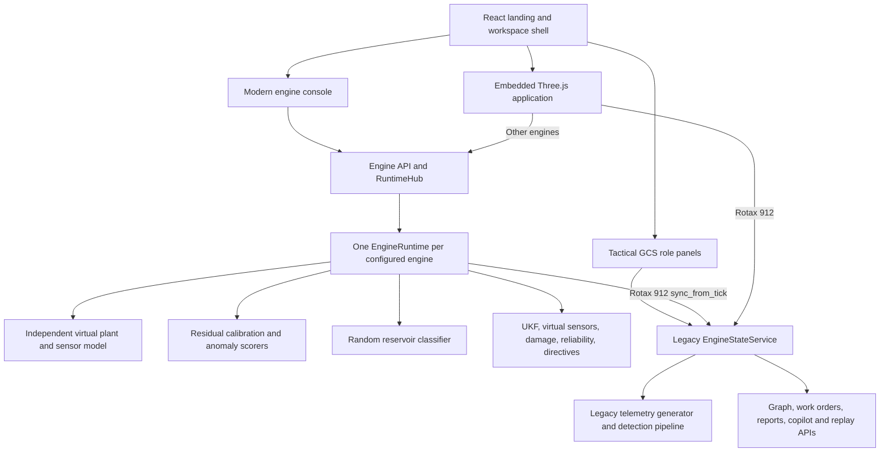

# ANUMAAN project and website review

Review date: 4 November 2026. Website inspected in the user's open Chrome session at https://www.midnight-ciphers.in/. This is an assessment; application code was not changed.

The user subsequently clarified that the requested emphasis is visual and graphical. The current presentation-focused deliverable is **VISUAL_AUDIT.md** in this directory; the technical findings below are retained separately for later discussion.

## Assessment

ANUMAAN has enough implemented material for a substantial SIH software demonstrator. Its principal weakness is inconsistent integration: multiple implementations publish different meanings under the same field names, while presentation components fill missing evidence with plausible numbers and confident explanations. Fixing that is more valuable than adding more models, animations, or AI features.

The defensible product is an engine-health investigation workspace: choose a virtual engine, set its operating conditions, introduce a controlled degradation, compare observed channels with an independent reference, inspect the evidence for an anomaly, and replay the event. The supplied problem-statement document explicitly permits demonstration with simulated or real engine datasets. Physical aircraft integration is a later validation milestone, not a prerequisite for a useful SIH simulation demo.

## Coverage and limits

- Inventoried **17,874 files / 65,690,911,207 bytes**, excluding dependency/cache directories, Git internals, environment secrets, editor/agent configuration, symlinks, and these review outputs. Most bytes are datasets, models, archives, and reference repositories.
- Structurally indexed **306 source files**: 141 backend Python files, all 49 frontend source files, 41 test files, 8 experiment files, and 67 Python scripts. All indexed Python files parsed successfully. Structural indexing means reading syntax, imports, module descriptions, and symbols; it is not a claim that every file received a line-by-line semantic audit.
- Deeply traced the live React application, both backend state pipelines, the runtime detector/observer/diagnosis/prognostics bridge, Three.js loading and stream selection, maintenance, voice availability, replay, configuration, and evaluation claims.
- The repository's own static reachability audit identifies **66 backend implementation modules reachable from the server, 23 harness-only modules, and 30 test-only modules**. This is static import reachability, not proof that every branch executes.
- Visited the landing page, modern runtime, embedded twin, all six Tactical GCS tabs, engine/airframe selectors, and image mode. Read the landing page's complete accessible content. No public fault scenarios, aircraft commands, AI messages, recordings, or maintenance signoffs were submitted for this review.
- Initial empty landing grid was later followed by successful model rendering; it is a loading/performance finding, not proof that the landing viewer is permanently broken. A subsequent visit verified that the embedded Rotax 912 twin also completes loading and renders; exploded and thermal views were inspected. Its loading time was not measured under controlled conditions.
- Direct network probes were unavailable from the shell and web reader. Live findings below come from Chrome observations, not independently captured HTTP responses. A deployed commit/hash was not available, and deployed viewer controls differ from the checked-out component, so source findings and live observations are distinguished.
- Raw datasets, every binary asset, external/reference repositories, archived apps, all documentation, hardware behavior, mobile layouts, and every fault/engine combination were not exhaustively validated. No full-suite pass or production readiness is claimed.

Companion files: `file-inventory.json`, `SOURCE_INDEX.md`, `source-index.json`, `backend-reachability.json`, `frontend-reachability.json`, `reproduce_findings.py`, and `probe-results.json` in this directory.

## How the system actually fits together

`frontend/src/App.tsx` is the website's workspace shell. `web/site` is a separate older presentation application; changing it would not fix the current React website. `web/usavionix` is a reference mirror/analysis area. Blender, Pygame, and the standalone mission graph viewer are additional clients.

The current code no longer matches the older statement that the modern runtime has no observer, RUL, reliability, or diagnosis fields. `EngineRuntime` now computes and serializes those fields, but the modern React `EngineFrame` type and console omit them. Several of the new computations also have the defects below, so simply exposing every backend field would amplify misleading information.

## Priority findings

P0 means correct before presenting the corresponding output as trustworthy. P1 means important for a coherent, reliable demonstrator. P2 means product/maintenance improvements. These priorities concern the software demonstrator, not a claim that this is deployed flight-control equipment.

### F01 — P0: two producers write incompatible snapshots into the legacy service

**Observed:** Tactical GCS showed GO for an 18-hour sortie with conservative RUL 0.0 h, median RUL 0.9 h, mission reliability 0.00%, and a 10% health index. Other observations switched the health index to 100%. No scenario was injected during this review.

**Cause:** `EngineStateService._run_loop()` computes legacy state. Separately, `RuntimeHub.tick_all()` passes modern Rotax 912 ticks to `sync_from_tick()`. Both write `latest_state`. The bridge deliberately retains previous diagnosis, sensor sanity, and Go/No-Go while replacing telemetry, RUL, reliability, and other analytics. A lock serializes writes but cannot make those mixed meanings consistent. It also overwrites legacy operating variables and engine-running state, so a legacy control can be undone by a subsequent runtime tick.

**Improve:** make one runtime the sole owner of an engine's state and control lifecycle. Serve old clients through a pure adapter of the same immutable tick. Carry engine ID, tail ID, run ID, sequence, source time, and provenance through every panel. Derive readiness from the same snapshot and represent unavailable/invalid evidence explicitly.

Evidence: `backend/runtime/hub.py:51`, `backend/server/engine_service.py:249`, `backend/server/engine_service.py:704`, especially lines 761–807. The in-memory `mixed_contract` probe reproduces GO with 0 h conservative RUL.

### F02 — P0: detector scores are being passed off as channel residuals and percentages

**Observed:** an anomaly score of 312.7% appeared beside a formula calculation of 0.0%; every actual/expected row could show identical values and zero residual.

**Cause:** the bridge assigns `d.scores` (Mahalanobis/max-Z/Fly Bloom scores) to the legacy `residuals` map. The UI expects keys such as `d_CHT_2`; missing keys become zero and expected values are reconstructed as actual minus zero. The largest raw scorer is also put into `anomaly_score`, whose legacy UI multiplies by 100.

**Improve:** separate channel observations, model expectations, physical residuals, standardized residuals, detector scores, threshold ratios, and calibrated probabilities. Missing residuals must display unavailable, never zero. Validate payload contracts at the adapter boundary. A raw anomaly score is not a percentage.

Evidence: `backend/server/engine_service.py:761`, `frontend/src/components/ReadingsPanel.tsx:91`, `ReadingsPanel.tsx:177`.

### F03 — P0: legitimate zero values become nominal invented measurements

**Reproduced locally:** a frame containing altitude 0 ft, OAT 0°C, oil pressure 0 bar, fuel flow 0, MAP 0, and bus voltage 0 emerged from the bridge as **20,000 ft, -20°C, 3.8 bar, 18 fuel-flow units, 90 kPa, and 14.1 V**.

**Cause:** expressions such as `f.oil_p or 3.8` treat zero as missing. Similar patterns occur inside runtime observer/virtual-sensor calculations.

**Improve:** distinguish `None` from zero; keep missing channels nullable and attach quality flags. Add explicit shutdown, sea-level, 0°C, empty/zero-flow, and power-loss cases. Do not replace absent aircraft data with healthy defaults.

Evidence: `backend/server/engine_service.py:730`, `engine_service.py:740`, `backend/runtime/engine_runtime.py:339`; `probe-results.json` contains the actual reproduction.

### F04 — P0: runtime diagnosis reads hidden simulator information

**Reproduced locally:** with identical observed Frame and fixed detector evidence, changing only hidden truth from MISFIRE to COOLING_DEGRADATION changed the directive from ignition misfire to cylinder overheat. Both were assigned **0.98 confidence**.

**Cause:** `active_inj` comes from `self.injected` or `truth.active_faults`; it drives fault/cylinder selection, component damage attribution, and the diagnostic directive. This bypasses inference. Renaming `fault_id` in the output does not remove the information leak. The pure tier-0 detector consumes Frame correctly; the leak is in downstream runtime orchestration.

**Improve:** isolate evaluation truth and operator-command annotations from every inference/prognostics input. Diagnosis should receive measured evidence and return hypotheses, ambiguity, and uncertainty. A scenario's known command can be displayed separately as a command, never as an inferred result.

The existing truth-leak test passes because it scans selected packages and a few uppercase attribute names, **not `backend/runtime` or `active_faults`/`self.injected` information flow**. Extend it with behavioral invariance tests: changing evaluator truth must not change any inferred output for an identical observation history.

Evidence: `backend/runtime/engine_runtime.py:426`, `engine_runtime.py:484`, `engine_runtime.py:518`, `tests/test_no_truth_leak.py:36`; reproducible script supplied.

### F05 — P0: maintenance invents life estimates and calls them guaranteed

**Observed:** all six maintenance components showed 500/650/800 h with “Guaranteed Coverage: 90%,” despite the operator page showing a near-zero limiting RUL.

**Cause:** missing per-component outputs fall through to literal 500, 650, and 800 in the frontend. The modern bridge supplies one differently shaped conformal interval and an empty component map. “Certified CBM” and “Guaranteed Coverage” are static copy.

**Improve:** return a typed per-component estimate with validity, calibration dataset, coverage target, measured coverage, and applicable engine/run. Show “not estimated” when absent. Use the same component identifiers everywhere. Remove certification/coverage language unless the displayed quantity has supporting validation.

Evidence: `frontend/src/components/MaintenanceDashboardPanel.tsx:196`, lines 204–206; `backend/server/engine_service.py:807`.

### F06 — P1: runtime RUL is a heuristic with artificial calibration data

`EngineRuntime.__init__()` calibrates its conformal object using 25 invented points and sine-wave perturbations. Its RUL point is a fixed 18-hour expression of accumulated damage, using cylinder 1's temperature; that damage is spread across cylinder heads for reliability. The interval code can be mathematically useful while the chosen calibration data provide no operational coverage evidence.

The separate `backend/prognose/rul.py` also calls an analytic fixed-percentage margin “conformal” without a held-out calibration step. It should not be promoted as a ready solution merely because its name matches the backlog.

**Improve:** first expose damage/trend as simulated model outputs. Establish a documented failure criterion and future-load assumption; estimate each affected component; evaluate on held-out degradation trajectories. Distinguish an interval's coverage level from percentile labels: a central 90% interval is not automatically a p10–p90 interval.

Evidence: `backend/runtime/engine_runtime.py:147`, lines 407–416; `backend/prognose/rul.py:73`.

### F07 — P1: scientific stages use inconsistent time steps

Each runtime tick advances one simulated second. The hub aims for 20 ticks per wall-clock second, while idle engines are advanced only every fifth hub tick. The UKF is invoked every fifth runtime tick but predicts using `dt=1`, so its prediction advances one second after five seconds of observations. Sensor histories also retain assumptions from the legacy 20 Hz path.

**Improve:** make simulated time and wall-clock time explicit, carry elapsed time between observations, integrate each stage over its actual elapsed interval, and show the acceleration factor. Define the intended idle-engine clock behavior; selection should not silently change simulated aging rate. Test deadline/latency on the deployed host rather than labeling a nominal loop “20 Hz synchronous.”

Evidence: `backend/runtime/engine_runtime.py:40`, lines 338–341; `backend/runtime/hub.py:40`, `hub.py:64`.

### F08 — P1: vibration data are generated separately from the faulted plant, with unit mismatches

The live order tracker is called with RPM and throttle, without raw measured acceleration or the plant's bearing/gear fault state. It synthesizes another waveform. `OrderSpectrumReport` names amplitudes in g, but legacy display fields label them mm/s. The bridge adds every order, including `total_rms`, to form “gearbox RMS,” which is not a valid RMS aggregation and double-counts the overall quantity. Gear-mesh frequency formulas also differ between producer and UI.

**Improve:** connect the actual fault-aware waveform source or measured acceleration to DSP, specify units per channel, and use a documented conversion if velocity is required. Keep scalar-observable and waveform-only fault capabilities distinct. Validate a paired nominal/fault waveform and demonstrate that the detector's actual inputs change.

Evidence: `backend/runtime/engine_runtime.py:332`, `backend/dsp/order_tracker.py:26`, `backend/server/engine_service.py:736`, `frontend/src/components/PropulsionEngineerPanel.tsx:45`.

### F09 — P1: sensor quarantine can use command knowledge or suppress real behavior

`set_sensor_fault()` quarantines the named channel before observing its response. That makes a sensor-fault demonstration partly command-driven. The shared validator is hardcoded to four cylinders and includes low-noise/frozen-channel and shift rules from a different cadence. MAP and oil pressure were quarantined during the live visit, while nominal-state messaging remained confident.

**Improve:** keep test injection separate from sensor validation, parameterize channels/noise floors from the engine/source, use elapsed time, and expose “evidence unavailable/quarantined” in the main status. A quiet detector after shielding is not evidence of engine health. Verify recovery behavior and sensor-versus-engine ambiguity with blind scenarios.

Evidence: `backend/runtime/engine_runtime.py:288`, `backend/physics/sensor_validator.py:110`.

### F10 — P1: several engineering readouts are constants or mislabeled quantities

The legacy bridge hardcodes injection/ignition timing, pulse width, AFR, thermal efficiency, BSFC, lane, battery current, and rail pressure. Its fuel flow is copied from a kg/h Frame into a schema/UI labeled L/h. The propulsion page presents these as live engineering values. The header also says “Ladakh FL200 (-22°C)” while the same screen reports 9,000 ft and +10°C. A virtual TIT is shown for the naturally aspirated profile.

**Improve:** label each quantity measured, estimated, assumed, or unavailable. Convert fuel mass flow using the selected fuel density if the UI needs volume. Read limits/gear ratios/timing applicability from profile schema. Show actual operating conditions in the header and omit inapplicable subsystems.

Evidence: `backend/core/frame.py:81`, `backend/server/engine_service.py:748`, `backend/server/schemas.py:37`, `frontend/src/components/Header.tsx:81`.

### F11 — P1: live connection status does not establish freshness or rate

The modern hook marks the connection live on WebSocket open and retains the last frame. There is no frame-age timeout or heartbeat-based stale state. Poll fallback is 1 Hz but still receives the “LIVE · 20 Hz SYNCHRONOUS” label. A pending HTTP response can also commit after selection changes because the post-await success path does not recheck the active engine/generation. Fleet data have no independent freshness indicator. The legacy “latency” field sometimes measures message spacing, not network RTT.

**Improve:** track last received wall time, monotonic source sequence/time, actual arrival rate, transport mode, selected engine, and request generation. Abort/discard old requests. Show connecting/calibrating/live/stale/disconnected/replay states; disable commands when the relevant stream is invalid. Measure network RTT separately if displayed.

Evidence: `frontend/src/hooks/useEngineRuntime.ts:87`, lines 97–110; `frontend/src/hooks/useTelemetrySocket.ts:190`.

### F12 — P1: scenario controls and engine selection are not shared across views

**Observed:** modern controls initialized to 70% / 12,000 ft, while the engine reported 60% / 9,000 ft. They remain frontend local drafts, and each slider release submits all three values, potentially changing untouched fields. The console initializes its own Rotax 912 selection; the iframe also defaults to Rotax 912 because App does not pass its selected engine. Landing selection is another independent local state.

**Improve:** share selected engine/tail/run at workspace level. Show target and measured values separately, initialize drafts from authoritative targets, send only changed fields, and make Apply behavior consistent. Pass engine identity to the twin and verify all panels agree after switches and reconnects. Use URLs for shareable workspace/engine selection and working browser Back behavior.

Evidence: `frontend/src/components/EngineRuntimeConsole.tsx:16`, `frontend/src/hooks/useEngineRuntime.ts:41`, `frontend/src/App.tsx:178`, `apps/threejs_twin/index.html:2715`.

### F13 — P1: heavy and duplicated 3D assets hurt the first useful experience

**Observed:** initial landing grid was empty; it later rendered. Secondary models loaded and rendered, but their previous model's mesh statistics remained visible while loading. The twin visit showed “1%” loading while telemetry was already arriving.

**Measured locally:** the landing Rotax 912 asset is 16.8 MB with roughly two million indexed triangles. The embedded twin's corresponding asset is **81.1 MB**; Rotax 915 is **83.2 MB**. After initial load the twin preloads its other engine assets. These are large for a dashboard delivered through a constrained backend host.

**Improve:** use a low-detail first model and an immediate rendered poster, lazy-load high detail, reuse one versioned asset manifest, cap decoded cache size, deduplicate in-flight loads, dispose geometries/materials/textures/controls on unmount, and offer retry/image fallback on failure. The landing source starts its initial load from two effects; it has a loaded cache but no in-flight promise cache. Do not advertise geometry loading as digital-twin calibration.

Evidence: `frontend/src/components/landing/LandingHero3D.tsx:316`, `LandingHero3D.tsx:400`, `apps/threejs_twin/index.html:1338`, `index.html:2802`; local GLB headers/metadata inspected.

### F14 — P1: diagnosis explanations and AI readiness are confident templates

**Observed:** “NOMINAL_FLIGHT (99% confidence)” was accompanied by claims of all 27 channels within FAA/EASA certified limits, zero fleet sensor drift, and a 100% subsystem index, while other panels reported quarantined channels and 10% health. “RAG index ready” is displayed without checking RAG availability in this component. Voice reported STT ERROR, TTS ERROR, LLM DISABLED, and unavailable in hosted demo.

**Improve:** build explanations from the current evidence snapshot, with links to the actual supporting channel/time and document edition/section/page. Query capability/readiness status for LLM, retrieval, STT, and TTS. Clearly identify deterministic templates. Keep voice optional; hide/disable unavailable hosted functionality with a useful reason. Verify directive/manual citations against supplied primary manuals before calling them authoritative. No manual instruction was operationally validated in this review.

Evidence: `frontend/src/components/DiagnosticCard.tsx:214`, `backend/agent/diagnostic_agent.py`, `frontend/src/components/VoiceCopilot.tsx:639`.

### F15 — P1: public sessions share mutable simulator and maintenance state

`get_hub()` is a process singleton, `selected` is global, and fault/lever endpoints mutate shared runtimes. No authentication/authorization dependency is declared on those routes or maintenance signoff. The UI uses a typed inspector string as identity. One visitor can therefore affect another visitor's scenario or heavy-tier scheduling if the deployed backend uses these routes unchanged. The live maintenance queue showed 508 open orders; all are rendered and refreshed without pagination.

**Improve:** provide an isolated seeded demo run per visitor, or make the public mode read-only and keep a dedicated controlled presenter session. Add server authorization and an auditable identity for persistent maintenance actions. Bound background work, payload sizes, and work-order queries. Static CORS configuration does not establish action authorization. No destructive or signoff endpoints were exercised.

Evidence: `backend/server/engine_api.py:29`, `backend/runtime/hub.py:26`, `backend/server/main.py:359`, `frontend/src/components/MaintenanceDashboardPanel.tsx:47`.

### F16 — P1: replay is present but cannot be demonstrated on the hosted page

**Observed:** the sortie selector contained only the disabled placeholder. No replayable mission was available.

The legacy replay API reads `report_dump/mission_*/...` bundles, whereas the modern runtime retains a different in-memory frame history and event log. The frontend does not connect modern history/events to an investigation timeline. In `useMissionReplay`, an in-flight old mission response can overwrite the newly selected mission; paused seeks made while a request is busy are dropped rather than guaranteeing the latest requested frame wins.

**Improve:** ship at least one clearly labeled seeded demonstration sortie with faults/events, use one canonical recording format across live/replay/evaluation, add request cancellation/generation checks and a pending latest seek, and display exact recorded time/source/engine. Provide a useful empty/error state and an export path.

Evidence: `backend/telemetry/replay_engine.py:59`, `frontend/src/hooks/useMissionReplay.ts:116`, `backend/server/engine_api.py:95`.

### F17 — P2: landing page communicates ideas better than proof or navigation

The editorial typography and consistent palette work. The explanation of residuals is approachable. However, the left navigation is a set of visually identical dashes until hover, primary CTAs lead to different backend paths, and the page spends significant space explaining absent claims. Evidence cards name E17/E19/E20 without opening the actual record, sample trace, methods, or result. Phrases about “materials reviewed” read like an audit note rather than a product explanation.

**Improve:** lead with the concrete outcome “detect developing engine faults before a fixed limit,” followed by one honest recorded example. Use visible section labels and one primary “Run a demo” CTA. Show baseline, divergence, anomaly confirmation, hypothesis, and time-to-action on a single timeline. Place concise simulation boundaries beside the example; retain methodological detail in documentation. Make experiment cards open reproducible records with seeds, split, units, uncertainty, and limitations.

All eight landing content sections were read. The comparison, observer, temporal-model schematic, diagnosis chain, evidence list, prototype flow, engineering maturity, and boundaries form a sensible sequence; they need a demonstrable example tying them together.

### F18 — P2: model identity/specification/provenance is inconsistent

**Observed:** “Predator-Class MALE UAV” in 3D changed to a different twin-boom aircraft render in Image mode. The source explicitly pairs `uav_predator.glb` with `sc_bayraktar_tb3.png`. The profile loader aliases AE300 to an AE330 asset manifest, but the landing presentation does not disclose the proxy. VRDE assumptions are not consistently differentiated from verified specifications. Static asset filenames are cached immutable for a year despite lacking content hashes/versioning.

**Improve:** use one manifest for asset identity, actual/proxy status, copyright/source, engine parameters, verified/assumed values, and fault/mesh mappings. Version URLs on asset changes. Verify specifications against primary manufacturer material before publishing them; no independent specification certification is claimed here.

Evidence: `frontend/src/components/landing/aeroLineup.ts:172`, `backend/core/profile.py:23`, `frontend/vercel.json:9`.

### F19 — P2: research module names overstate their present implementation

These paths are mostly separate from the website, but they matter to the project's claimed technical depth:

- `foundation/forecast_chronos.py` performs weighted linear regression with an expanding normal-error band, not Chronos inference. Its p10/p90 labels use a 1.645 multiplier (central 90% normal band), inconsistent with those quantile names.
- `foundation/tabpfn_wrapper.py` performs normalized RBF similarity weighting, not TabPFN inference. `text_classifier.py` is keyword classification with a heuristic confidence.
- `diagnose/bn.py` declares the isolability file but does not load it; symptom direction/statistic is not used in the score update. Fixed likelihood increments are not an independently calibrated Bayesian diagnostic model.
- `diagnose/active.py` estimates information gain from ambiguity counts, rather than an explicit test-outcome likelihood model.
- `federation/aggregator.py` adds noise without an explicit clipping/sensitivity/privacy-accounting mechanism; this is not sufficient evidence for a formal differential-privacy guarantee. An empty canary set yields zero loss and accepts an update.
- E25 labels accuracy as macro-F1 merely because classes are balanced; balanced classes do not make the two metrics identical. E22 describes active-test selection as validated while its saved recommendation is null.

**Improve:** rename/document the actual baselines, add explicit capability flags, and separate planned model integrations from measured implementations. Preserve useful statistical baselines. Validate directions, ambiguity, likelihoods, privacy assumptions, and evaluation metrics before making stronger claims.

### F20 — P2: documentation and code organization obscure the current application

`README`, `MENTAL_MODEL`, `CURRENT_STATE`, historical audits, experiment artifacts, implementation logs, and source bodies disagree on what is live. Thirteen older landing TSX components and one stylesheet were not found in the import graph from `main.tsx` (the ambient `vite-env.d.ts` is naturally outside that graph). The static presentation, React landing, embedded viewer, and docs site maintain overlapping assets/profiles.

**Improve:** keep a short current runtime map generated from entry points, a versioned API contract, a claims-to-evidence table, one engine/asset manifest, and an explicit research/archive boundary. Add deployed frontend/backend build identifiers. Do not delete files based solely on the static index; check independent entry points first.

## Module-by-module disposition

| Module / area | Current role | What should improve next |
|---|---|---|
| Landing / splash / rail | Explanation and model showcase | Clear navigation, useful first frame, accessible motion/loading controls, one coherent demo CTA |
| Engine runtime console | Five-engine simulated fleet, scores, scenario controls | Freshness, authoritative controls, selected-engine continuity, trend/event history |
| Embedded Three.js twin | Separate viewer/app; legacy route for 912, modern routes for others | Shared stream and engine ID, asset sizes, command-vs-diagnosis highlights, fallback/retry |
| Operator Flight Deck | Legacy controls/readings/readiness | F01–F03; consistent units and availability; prioritize active issue/evidence/action |
| Propulsion Engineer | Performance, timing, comparator, observer diagnostics | Remove constant-as-measured displays; consistent frequencies/units/limits; real traces |
| Maintenance & CBM | RUL cards, persisted work-order list, signoff | Remove invented estimates; shared component IDs; authorization/pagination; calibration provenance |
| AI Reasoning & RAG | Rule directives and optional copilot | Snapshot-grounded explanations, actual retrieval/model status and verifiable citations |
| Voice Copilot | Local STT/LLM/TTS interface; unavailable hosted | Capability-aware UI; local deployment validation; keep out of the essential demo path |
| Mission Replay | Legacy report-bundle player; hosted selector empty | Seed a recorded scenario; canonical recording; correct request/seek lifecycle |
| FastAPI/server schemas | REST, WS, assets, optional services | One state owner, typed/versioned semantics, input limits, failure handling and service lifecycle |
| RuntimeHub/levers/registry | Per-profile simulation, selection, commands | Explicit clocks, isolated runs, target readback, stable fault identifiers, bounded heavy initialization |
| Frame/profile/channels/limits | Good basis for engine-agnostic contracts | Carry quality/timestamps/provenance through public payloads; remove healthy defaults |
| Independent plant/physics | Engine/sensor dynamics and controlled fault generation | Profile-specific thermal/operating validation; blind fault observability; separate truth |
| Tail calibration/scorers/gate | Nominal operating-point residual detection | Held-out per-tail/operating-envelope testing, combined alarm-rate evidence and transient checks |
| Reservoir/FlyBrain | Runtime random reservoir; connectome research comparison | Freeze/version models, held-out seeds/tails, report random-control results, gate on sufficient history |
| UKF/model/virtual sensors | Now called in runtime | Correct dt, initialization, observability, calibrated covariance and per-field estimate labels |
| Validity/integrity | Validity connected; integrity path separate | Gating behavior when invalid, distinguish missing sensors/model drift/engine fault honestly |
| DSP/high-rate source/crank | Live synthetic order summaries; separate fault-aware CycleBlocks | Join fault-aware waveform acquisition, DSP, recorder, detector and UI with units |
| Damage/RUL/conformal | Multiple implementations, some connected heuristics | Per-component failure model and independent calibration; do not wire by class name alone |
| Mission reliability/glide | Connected assumptions-based calculation | Remove truth-driven damage attribution; parameter provenance; plan/position/airframe inputs; one advisory |
| FMECA/isolability/BN/active tests | Supporting research/harness code | Mode×location taxonomy, actual signatures/likelihoods, ambiguity and test-outcome validation |
| FADEC emulator | Separate simulated capability | Closed-loop scenario tied to plant, supported profile/actions and traceable test results |
| Graph/reports/work packages | Legacy graph/report persistence; separate package generator | One modern run/event identity, deduplication, traceable evidence, bounded queries |
| Sources/recorders | Canonical scalar/waveform recording utilities | One replayable artifact from the actual user scenario, source/quality/seed/version metadata |
| CAN/MAVLink/ACES ingestion | Separate adapters/parser, not selected by main runtime | Contract/unit validation and source selection; replay a real log before hardware claims |
| Dataset adapters | Explicitly synthetic illustrative generators | Keep SIMULATION label; implement actual parsers before external-data validation claims |
| Edge/link/security | Separate emulation/accounting/security libraries | Measured hardware/link behavior, run integration and realistic fault/disconnect tests |
| Federation/fleet/economics | Research/simulation components | Privacy/validation assumptions, component heterogeneity, operational evidence before product claims |
| Foundation wrappers | Statistical/kernel/keyword baselines | Accurate model names and metrics; genuine model adapter only if it improves held-out performance |
| Blender/Pygame/graph apps | Independent local clients | Preserve as separate tools; make their schemas and chosen run consistent if retained |
| `web/site` / reference mirror | Older presentation and design reference | Avoid fixing the wrong app; consolidate only after choosing authoritative product/asset sources |
| Tests/evaluation/docs/deployment | Significant infrastructure already exists | Behavioral invariants, recorded end-to-end run, current reachability/claims/build identifiers |

## Evaluation observations worth retaining

The architecture already has valuable elements: an independent virtual plant, explicit Frame/TruthRecord separation, per-tail calibration, persistence-gated anomaly detection, profile-valid faults, engine configuration provenance, local recording/replay utilities, and testable optional services. The newer synthetic dataset adapters now correctly mark their data SIMULATION; old documents saying those adapters still advertise REAL_FLIGHT are stale.

E19 contains a comparison with shuffled and random reservoirs. On Rotax 914, the saved random-reservoir mean is slightly above the connectome mean, within substantial seed variation; on VRDE the three are very close. This supports continuing temporal-reservoir investigation, not claiming a demonstrated biological-connectome advantage. These saved experiments were inspected, not rerun or independently revalidated.

## Recommended implementation order

1. **Make one engine state trustworthy.** Retire dual writes, establish one tick/command owner, repair score/residual/unit contracts, preserve zeros, and add snapshot invariants. Keep current UI until its numbers agree.
2. **Make missing evidence honest.** Remove invented RUL/health/confidence/readiness defaults; expose quality/freshness/validity and actual service availability. Keep uncalibrated outputs labeled experimental.
3. **Make one blind fault investigation work end to end.** Fixed seed and operating schedule; fault known only to evaluator; observable evidence, confirmed anomaly, plausible hypotheses and uncertainty; unaffected engine stays nominal. No command-derived diagnosis.
4. **Add history and replay to that exact run.** Timeline should show conditions, expected/measured channels, injection annotation, detection, clearing, and recovery. Export artifact/version/seed and replay the same data through the same analysis path.
5. **Make the UI one workspace.** Shared engine selection, consistent controls and statuses, linked 3D component/evidence, clear role views, lightweight first model, available hosted features only.
6. **Strengthen scientific validation.** Correct clock/observer/waveform plumbing, per-engine characterization, held-out seed/tail/mission splits, per-fault recall and delay, false alarms per simulated hour with uncertainty, calibration coverage and limitations. Re-baseline results after pipeline changes.
7. **Polish the presentation around that evidence.** One short narrated example and accessible navigation, then technical depth. Bring aircraft/test-rig ingestion, waveform-specific diagnosis, federation and advanced prognostics forward only when connected and validated.

The first concrete slice should be **one authoritative Rotax runtime snapshot shared by runtime, Tactical GCS and 3D**, including zeros, units, expected values, detector state, and advisory consistency. This directly addresses the most visible and damaging demo failures without expanding scope.

## Verification performed

- TypeScript: `node ../frontend/node_modules/typescript/bin/tsc --noEmit --project ../frontend/tsconfig.json` passed.
- Five focused backend files: no-truth-leak guard, residual detection, Frame/plant source, engine-config provenance, sensor levers/replay. Initial run: 41 passed and one test setup error because the review temporary directory did not yet exist. After creating it, that one calibration round-trip test passed. Thus all **42 selected checks passed**, with the setup correction disclosed.
- Local in-memory probes reproduced zero-value substitution, an internally contradictory GO/RUL snapshot, and diagnosis depending on hidden truth. Probe code does not start a server or modify product state.
- Static source/index/reachability checks completed; all indexed Python parsed. Frontend import graph has 34 reachable source/style files, 13 older landing components, one unused stylesheet, and one ambient declaration outside that graph.
- Additional API tests were attempted separately, first the full engine API file and then with WebSocket cases excluded. Neither attempt produced a completion/result during the review, and both were interrupted. The cause of the stall was not established. No API/WebSocket suite pass is claimed; investigating this test/runtime lifecycle is an outstanding verification task.
- Live Chrome inspection confirmed contradictions, maintenance fallback values, unavailable voice, empty replay selection, independently selected workspaces, and asset-loading/identity problems described above. Model load completion varied; it was not a controlled benchmark.

No application fixes, dataset modifications, deployments, maintenance signoffs, or public scenario mutations were made by this review. Review artifacts alone were created under `web/review/`.
